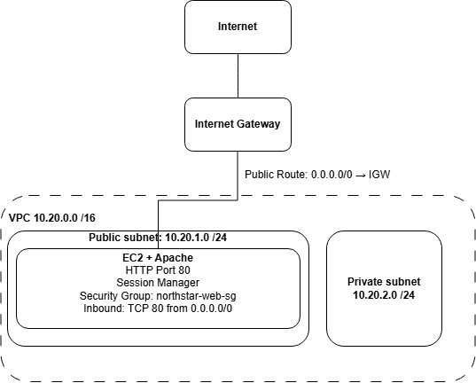

# AWS-001 — Secure AWS Infrastructure Deployment

## Project Overview

This project simulates an AWS Cloud Infrastructure Engineer deploying, configuring, and troubleshooting infrastructure for a fictional company, **Northstar Solutions**.

The objective was to build a custom AWS network, deploy a Linux web server, establish secure administrative access, and investigate a simulated service outage.

## Technologies Used

- Amazon VPC
- Amazon EC2 (Amazon Linux 2023)
- AWS IAM
- AWS Systems Manager Session Manager
- AWS Security Groups
- Internet Gateway and Route Tables
- Apache HTTP Server
- Linux CLI

## Infrastructure Architecture

- **AWS Region:** us-east-2 (Ohio)
- **VPC:** 10.20.0.0/16
- **Public Subnet:** 10.20.1.0/24
- **Private Subnet:** 10.20.2.0/24
- **EC2 Instance:** Amazon Linux 2023, t3.micro
- **Web Server:** Apache HTTP Server
- **Administration:** AWS Systems Manager Session Manager
- **Public Web Access:** HTTP, TCP port 80

The EC2 instance was deployed in the public subnet with internet access through an Internet Gateway. Administrative access was configured using Session Manager without enabling inbound SSH.

## Deployment and Validation

1. Created a custom VPC and public/private subnets.
2. Configured an Internet Gateway and public route table.
3. Configured a security group permitting inbound HTTP traffic.
4. Launched an Amazon Linux EC2 instance with encrypted EBS storage.
5. Attached an IAM role for Systems Manager access.
6. Installed and enabled Apache.
7. Created and deployed a demonstration website.
8. Validated HTTP responses locally and confirmed public browser access.

## Incident Response — INC-1002

**Incident:** Northstar website unavailable from the internet.

**Investigation:** The website failed externally, but the local server returned `HTTP/1.1 200 OK`. Inspection of the EC2 security group revealed that no inbound rules were configured.

**Root Cause:** Missing inbound HTTP rule permitting TCP port 80.

**Resolution:** Restored the inbound HTTP rule and verified that the website was accessible again.

## Skills Demonstrated

- AWS networking and infrastructure provisioning
- Linux server administration
- IAM-based administrative access
- Network security configuration
- Connectivity troubleshooting
- Incident root-cause analysis
- Service restoration and validation

## Project Status

Infrastructure deployment and incident simulation completed. Portfolio documentation and final resource cleanup are in progress.

**Note:** This project is a temporary learning environment. The demonstration website uses HTTP without TLS and is not intended for production or sensitive data.
